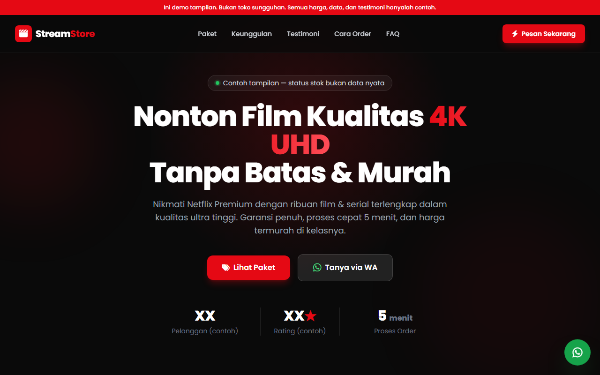

<div align="center">

# 🎬 StreamStore — Demo Landing Page Akun Netflix Premium

### Contoh landing page statis untuk jualan akun Netflix Premium 4K UHD.

[](https://netflix.massbim.my.id)
[](https://github.com/bimofakot/streamstore/actions/workflows/firebase-hosting-merge.yml)
[](./LICENSE)
[](https://tailwindcss.com/)
[](https://firebase.google.com/products/hosting)

</div>



---

## 📖 Tentang Project

**StreamStore** adalah demo landing page statis bertema Netflix (hitam, abu-abu gelap, dan merah `#E50914`). Halaman menampilkan hero, katalog paket, keunggulan layanan, testimoni contoh, FAQ, dan tombol pesanan.

Demo ini **belum terhubung ke toko mana pun**:

- Semua tombol WhatsApp dan Shopee memakai `href="#"`.
- Angka pelanggan, rating, stok, dan testimoni adalah contoh, bukan data nyata.
- Tidak ada checkout, pembayaran, atau data pesanan.

Gunakan halaman ini sebagai titik awal, lalu ganti tautan dan data contoh sebelum dipakai berjualan.

> 🔗 **Demo Live:** <https://netflix.massbim.my.id>

---

## ✨ Fitur Utama

| Fitur | Deskripsi |
| --- | --- |
| 🦸 **Hero Section** | Judul, deskripsi penawaran, dua CTA, dan statistik contoh. |
| 📦 **Katalog Paket** | Tiga kartu paket contoh dengan rincian fitur dan harga. |
| 💬 **Tombol Pesanan** | Tombol WhatsApp dan Shopee contoh; tautan diisi manual di `index.html`. |
| 🛡️ **Keunggulan Layanan** | Section USP: garansi, proses cepat, dan CS responsif. |
| ⭐ **Testimoni Contoh** | Enam kartu testimoni contoh dengan rating bintang. |
| ❓ **FAQ Accordion** | 4 langkah cara order + 5 pertanyaan interaktif yang bisa diklik. |
| 📱 **Fully Responsive** | Tampil optimal di mobile maupun desktop, dengan menu hamburger & layout adaptif. |
| 🎨 **Animasi Halus** | Scroll-reveal, hover effect, floating WhatsApp button, dan navbar dinamis. |

---

## 🛠️ Tech Stack

- **HTML5** — markup halaman tunggal di `index.html`.
- **Tailwind CSS 3.4** — kelas utilitas dikompilasi menjadi `styles.css` statis; tidak memakai Play CDN.
- **CSS kustom** — ditulis di `styles.src.css` setelah direktif `@tailwind`.
- **JavaScript vanilla** — perilaku halaman di `app.js`.
- **FontAwesome 6** dan **Google Fonts (Poppins)** — dimuat dari CDN.
- **Firebase Hosting** — hosting statis dan SSL.

Repo ini tidak memakai `package.json`, `node_modules`, atau langkah build di CI. Tailwind CLI hanya dipakai saat mengubah CSS.

---

## 🚀 Panduan Penggunaan & Konfigurasi

### 1. Menjalankan Secara Lokal

Karena project ini statis, cukup buka `index.html` langsung di browser. Atau jalankan server lokal sederhana:

```bash
# Opsi A: Python
python -m http.server 5500

# Opsi B: Live Server (ekstensi VS Code)
# Klik kanan index.html → "Open with Live Server"
```

Lalu buka <http://localhost:5500> di browser.

### 2. Mengganti Tautan WhatsApp dan Shopee

Semua tombol pesanan masih memakai `href="#"`. Tidak ada objek `CONFIG`; ubah `href` langsung di `index.html` pada:

- `#waHeroBtn` di hero;
- dua tombol di setiap kartu paket (WhatsApp dan Shopee);
- `#waCtaBtn` di CTA bawah;
- tombol WhatsApp dan Shopee di footer;
- `#waFloatBtn` di tombol mengambang.

Contoh:

```html
<a id="waHeroBtn" href="https://wa.me/6281234567890?text=Halo%2C%20saya%20mau%20tanya%20paket%20Netflix">
```

Ganti juga angka contoh dan teks testimoni di `index.html` agar sesuai toko Anda.

### 3. Regenerasi CSS Statis

Jalankan perintah ini setiap kali kelas Tailwind di `index.html` atau `app.js` berubah:

```bash
npx -y tailwindcss@3.4.14 -c tailwind.config.js -i styles.src.css -o styles.css --minify
```

Commit `styles.css` hasilnya. `content` di `tailwind.config.js` memindai `index.html` dan `app.js` karena beberapa kelas hanya ditambahkan saat runtime.

### 4. Deploy ke Firebase Hosting

**Prasyarat:** pasang Firebase CLI terlebih dahulu jika belum.

```bash
# Install Firebase CLI (sekali saja)
npm install -g firebase-tools

# Login ke akun Firebase Anda
firebase login

# Deploy ulang ke Firebase Hosting
firebase deploy --only hosting
```

Konfigurasi hosting sudah tersedia di file `firebase.json` dengan direktori publik `"./"` (root project tempat `index.html` berada). Setelah deploy selesai, Firebase akan memberikan URL `*.web.app` dan `*.firebaseapp.com` yang aktif.

> 💡 Custom domain `netflix.massbim.my.id` cukup dikonfigurasi sekali di console Firebase → Hosting → Add custom domain. Perubahan konten tinggal `firebase deploy` ulang.

### 5. Deploy Otomatis lewat GitHub Actions

Repo punya dua workflow: `.github/workflows/firebase-hosting-merge.yml` untuk push ke `main` (deploy live) dan `.github/workflows/firebase-hosting-pull-request.yml` untuk pull request (preview channel). Deploy manual di atas hanya untuk keadaan darurat.

---

## 📁 Struktur Project

```
.
├── index.html          # Markup halaman
├── app.js              # Tahun footer, menu mobile, FAQ, reveal
├── tailwind.config.js  # Tema dan pemindaian kelas
├── styles.src.css      # Sumber CSS: @tailwind + gaya kustom
├── styles.css          # Hasil build Tailwind, ikut di-commit
├── firebase.json       # Konfigurasi Firebase Hosting (public: "./")
└── README.md
```

---

## ⚠️ Batasan Demo

- Tombol pesanan tidak mengarah ke WhatsApp atau Shopee sampai `href` diubah.
- Statistik, stok, dan testimoni hanya contoh.
- Tidak ada backend, checkout, atau penyimpanan data pembeli.
- Halaman ini tidak berafiliasi resmi dengan Netflix, Inc.

---

## 👤 Author

Dibuat dan dikembangkan oleh:

**Bimo Praharbiyanto**
🔗 GitHub: [https://github.com/bimofakot](https://github.com/bimofakot)

---

## 💬 Bantuan

Laporkan bug atau usul lewat [Issues](https://github.com/bimofakot/streamstore/issues). Sertakan halaman yang bermasalah, langkah reproduksi, dan tangkapan layar bila perlu.

---

## 📄 Lisensi

Project ini dilisensikan di bawah **MIT License**. Teks lengkap ada di [LICENSE](LICENSE).

---

<div align="center">

<sub>🎬 StreamStore — Dibuat dengan Tailwind CSS & Firebase Hosting.</sub><br>
<sub>Toko ini tidak berafiliasi resmi dengan Netflix, Inc.</sub>

</div>
